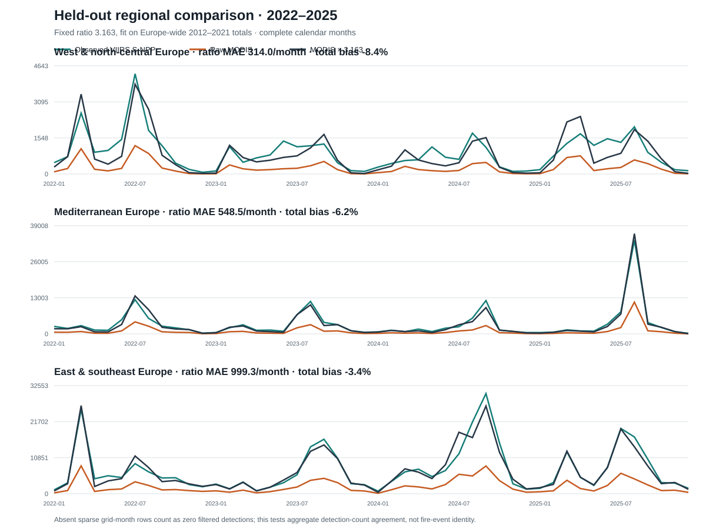

# FireChronos

**NASA Space Apps Challenge 2026 · Harmonization of MODIS and VIIRS Hot Spots**

FireChronos explores how satellite sampling changes the fire record. It combines filtered NASA active-fire detections into a monthly spatial archive, shows the MODIS-to-VIIRS transition, and makes the correction and its limits inspectable.

## Scientific problem

MODIS and VIIRS do not observe fires with identical pixel sizes, algorithms, and overpass histories. VIIRS S-NPP uses a 375 m active-fire product, while the MODIS active-fire record is about 1 km. VIIRS can respond to smaller fires, so raw detection counts jump when the record switches sensors. A hotspot is a thermal satellite detection, not necessarily a distinct wildfire, a fire perimeter, or its ignition time. NASA also cautions that clouds, smoke, canopy, and gaps between overpasses can hide fires. [NASA MODIS fire guide](https://www.earthdata.nasa.gov/s3fs-public/2023-09/MODIS_C6_C6.1_Fire_User_Guide_1.0.pdf) · [NASA VIIRS fire guide](https://www.earthdata.nasa.gov/s3fs-public/2024-07/VIIRS_C2_AF-375m_User_Guide_1.0.pdf)

## Solution and innovation

- An interactive Earth entry scene with MODIS and VIIRS orbital paths, leading into a 2001–2025 European archive on a 0.25° monthly grid.
- A Europe-only scope across 16 countries; map framing follows the selected years or month.
- A burning calendar, map, seasonal FireDNA summary, trend and spatial-extent views.
- A “How was this calculated?” panel that reports the selected-area observations and corrected totals, sensor availability, filters, formulas, and quality limits.
- ERA5 historical wind context at a selected or automatically suggested hotspot location. It is context, not causal attribution or a fire forecast.
- A timestamped Brandenburg June 2022 replay with per-detection sensor, type, day/night flag, confidence, and FRP, plus matched historical weather. The replay does not infer one incident perimeter or simulate movement between passes.

## Data

The committed archive contains **624 NASA FIRMS country/year CSV inputs** for **16 European countries**. MODIS runs from 2001 through 2025 (Terra; Aqua observations begin in July 2002). VIIRS coverage is **Suomi-NPP only**, from 20 January 2012 through 2025; NOAA-20 and NOAA-21 are not in this archive. The 2012 training overlap therefore starts with a partial VIIRS month. Source files are downloaded from NASA FIRMS [country data](https://firms.modaps.eosdis.nasa.gov/data/country/).

The monthly pipeline retains inferred hotspot `type = 0` (presumed vegetation fire), MODIS confidence ≥30, and VIIRS nominal/high confidence. It bins detection coordinates into 0.25° cells and counts retained detection records. It does not deduplicate repeated detections across satellite passes. FRP is summed per cell-month and sensor; this experimental sum is not burned area or cumulative energy. The harmonized grid omits daily timestamps and the day/night split; those attributes are shown only in the timestamped replay.

## Method

For each calendar cell-month, the **raw timeline** uses MODIS through 2011 and VIIRS S-NPP from 2012 onward. In the 2012–2021 overlap, the shipped count scale is the Europe-wide pooled ratio:

```text
count ratio = filtered VIIRS S-NPP detections / filtered MODIS detections
            = 1,796,302 / 567,985 ≈ 3.1626
```

The **corrected timeline** is MODIS count × 3.1626 before 2012, and observed VIIRS S-NPP count from 2012 onward. FRP uses a separately fitted overlap ratio of approximately 0.7237 and is experimental.

This is an aggregate scale adjustment, not matched-fire harmonization. It increases counts in cells MODIS detected but cannot add a cell where MODIS detected nothing. It may improve regional totals while leaving local spatial patterns biased. The fixed Europe-wide ratio is not validated for other continents or future years. The ML candidate is reported for comparison only; it is not the shipped correction.

## Validation

The ratio is trained on 2012–2021 and evaluated on held-out 2022–2025 data. The pipeline compares observed VIIRS with raw MODIS and the fixed-ratio estimate over **10,437 country × 2° block × month units with at least one sensor detection**. In this set, fixed-ratio MAE is 18.2 detections/unit (R² 0.943), versus raw MODIS MAE 37.6 (R² 0.497). These are aggregate detection-count agreement scores; they do not validate individual fires, burned area, ignition, or spread.

The separate three-region check includes all 48 calendar months in each group, including months with zero filtered detections:

| Held-out region (2022–2025) | Raw MODIS MAE / month | Fixed-ratio MAE / month | Fixed-ratio total bias |
|---|---:|---:|---:|
| West & north-central Europe | 655.29 | 314.01 | −8.4% |
| Mediterranean Europe | 2,413.00 | 548.52 | −6.2% |
| East & southeast Europe | 4,976.69 | 999.32 | −3.4% |



The region groups and month-level values are documented in [validation-three-regions.json](docs/validation-three-regions.json). These group results show the behavior of this ratio in the held-out European archive; they are not independent validation on new geographies.

## Limitations

- The application is intentionally scoped to its committed European archive; it does not present unsupported non-European regions.
- No fire-cause classifier, future-fire model, or spread prediction is implemented.
- Satellite detections are affected by pixel size, overpass timing, cloud/smoke/canopy obstruction, and algorithm confidence. No detection does not prove no fire occurred.
- The monthly data include type 0 only. Other thermal-anomaly types are filtered out, not represented as zero fire.
- The single overlap ratio is Europe-wide and can conceal country, season, and cell-level differences. FRP scaling is exploratory.
- Weather is sampled from ERA5 at one nearby grid point and cannot identify ignition cause or predict spread.

## Reproduce

Install Python dependencies from `requirements.txt`, then from the repository root:

```bash
python3 -m venv venv
venv/bin/pip install -r requirements.txt
venv/bin/python pipeline/01_download.py
venv/bin/python pipeline/02_harmonize.py
venv/bin/python pipeline/06_validate_regions.py
```

Copy refreshed cell data into the web app with `cd web && npm run copy-data`. To build the timestamped case again, run `venv/bin/python pipeline/04_build_observation_case.py` and copy its output into `web/public/case-studies/`.

Run the app with `cd web && npm install && npm run dev`. Validation checks are `npm test`, `npm run lint`, and `npx tsc --noEmit`.
